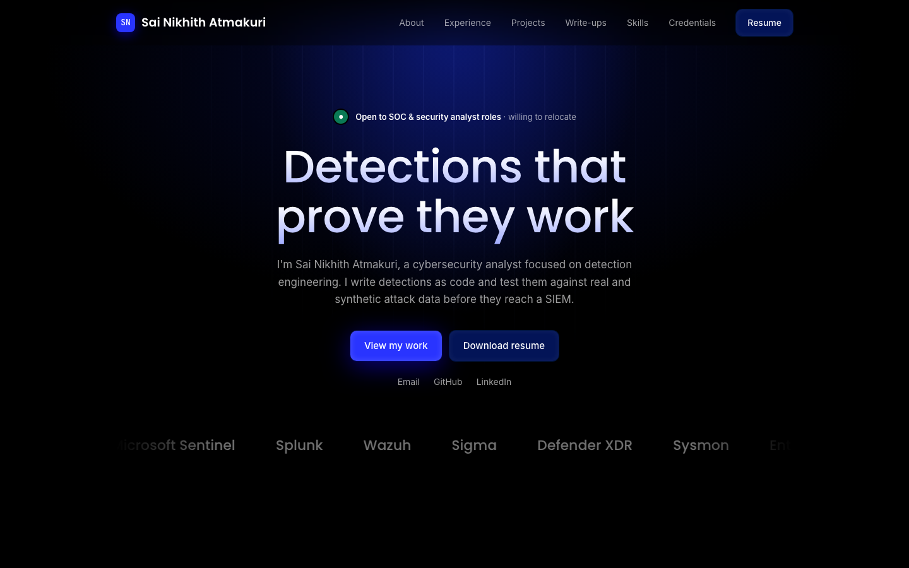
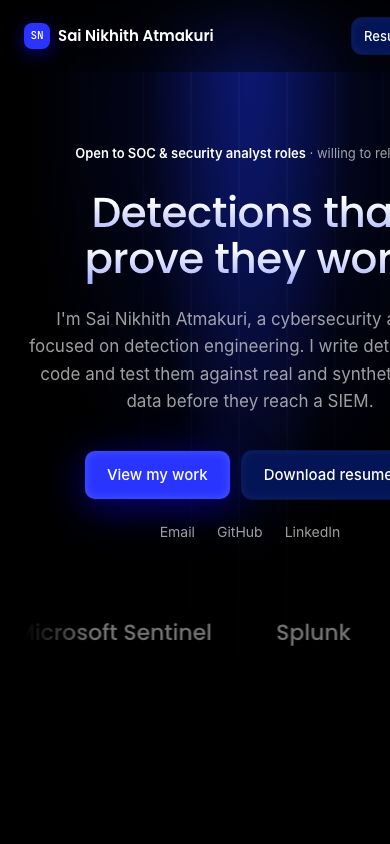

<div align="center">

# Sai Nikhith Atmakuri

### Security Analyst · SOC Operations · Detection Engineering

I write detections as code and test them against real and synthetic attack data before they reach a SIEM.

[](https://nikhith-ni7.github.io)
[](https://nikhith-ni7.github.io/resume.pdf)
[](https://www.linkedin.com/in/sai-nikhith-atmakuri-204b501b1/)
[](mailto:sainikhithatmakuri.v7@gmail.com)

<br>

<a href="https://nikhith-ni7.github.io"></a>

</div>

---

## About

I'm a Security Analyst with an **M.S. in Computer Science from Florida Atlantic University (GPA 3.93)**, certified in **CompTIA Security+** and **Microsoft SC-200**. My work covers SOC operations and detection engineering: building SIEM detections mapped to MITRE ATT&CK, testing them in CI, triaging alerts with a human in the loop, and writing incident reports the next analyst can act on.

**Open to:** SOC Analyst · Security Analyst · Detection Engineer roles · willing to relocate

## Featured projects

| Project | What it does | Highlights | Stack |
| --- | --- | --- | --- |
| [**Detection-as-Code Pipeline**](https://github.com/Nikhith-ni7/detection-as-code-pipeline) | Sigma rules for Windows threats, tested in CI and converted to Splunk SPL and Microsoft KQL | 12 rules · 11 ATT&CK techniques · 67 labeled test events | Sigma, Python, GitHub Actions, SPL, KQL |
| [**Sentinel Identity Detection Lab**](https://github.com/Nikhith-ni7/sentinel-identity-detection-lab) | KQL analytics rules for identity attacks with an automated containment playbook | 7 KQL rules · 6 validated Sentinel incidents | Microsoft Sentinel, Entra ID, Logic Apps, ARM |
| [**AI-Assisted Alert Triage**](https://github.com/Nikhith-ni7/ai-assisted-alert-triage) | Triage dashboard for Wazuh and Sentinel alerts with enrichment and analyst review | 76% on hard benchmark · 0 malicious alerts marked benign | Python, Wazuh, Ollama, VirusTotal, AbuseIPDB |
| [**Ransomware Precursor Investigation**](https://github.com/Nikhith-ni7/ransomware-precursor-investigation) | Detects and links Kerberoasting, AD CS ESC1 abuse and backup deletion | Full incident response report | Python, Active Directory, AD CS, Sysmon |

**Earlier labs:** [Backdoor HTTPS Attack](https://github.com/Nikhith-ni7/Backdoor-HTTPS-Attack) · [macOS Authentication Failure Detection](https://github.com/Nikhith-ni7/macOS-Authentication-Failure-Detection-Lab) · [ARP Spoofing & MitM](https://github.com/Nikhith-ni7/ARP-Spoofing-Man-in-the-Middle-Attack) · [Network Recon & Vulnerability Assessment](https://github.com/Nikhith-ni7/VMware-Network-Recon-Vulnerability-Assessment) · [Home Network Security Audit](https://github.com/Nikhith-ni7/home-network-security-audit)

## Skills

| Area | Tools and techniques |
| --- | --- |
| SIEM & XDR | Microsoft Sentinel, Microsoft Defender XDR, Splunk, Wazuh |
| Detection engineering | Sigma, KQL, Splunk SPL, MITRE ATT&CK, detection-as-code |
| Security operations | Alert triage, incident response, threat hunting, IOC enrichment, SOAR |
| Vulnerability & risk | CVE research (NVD), threat intelligence, NIST CSF, vulnerability assessment |
| Identity & cloud | Entra ID, Active Directory, AD CS, Azure Logic Apps, ARM, Microsoft Graph |
| Network & endpoint | Wireshark, tcpdump, Nmap, Sysmon, Windows event logs, Kali Linux |
| Programming | Python, PowerShell, Bash, SQL, JavaScript/TypeScript |

## Certifications

- Microsoft Certified: Security Operations Analyst Associate (SC-200)
- CompTIA Security+
- Microsoft Certified: Security, Compliance, and Identity Fundamentals (SC-900)
- Google Cybersecurity Professional Certificate
- Google IT Support Professional Certificate

## What's on the site

| Section | Contents |
| --- | --- |
| About | Background, quick facts, resume and LinkedIn |
| Experience | Work history and education timeline |
| Projects | Four detection projects with ATT&CK coverage and verified results, plus earlier labs |
| Write-ups | Incident reports and lab guides |
| Skills & Credentials | Toolkit and certifications |
| Contact | Email, LinkedIn and resume download |

<p align="center"></p>

## Built with

- Hand-written **HTML and CSS** in a single `index.html`: no framework, no build step and no trackers
- Fonts: Poppins, Inter and JetBrains Mono from Google Fonts
- Responsive layout with a mobile menu, scroll-reveal animations and reduced-motion support
- Open Graph tags for link previews on LinkedIn and other sites
- Hosted for free on **GitHub Pages**

## Repository structure

```
├── index.html          # the whole site: markup, styles and a small script
├── favicon.svg         # SN monogram icon
├── resume.pdf          # current resume
├── images/
│   └── profile.jpg     # profile photo
└── docs/               # screenshots used in this README
```

## Run locally

```sh
git clone https://github.com/Nikhith-ni7/nikhith-ni7.github.io.git
cd nikhith-ni7.github.io
python3 -m http.server 8000
```

Then open http://localhost:8000.

## Deploy

Every push to `main` is published automatically by GitHub Pages to https://nikhith-ni7.github.io. The previous version of the site is kept on the [`old-site`](https://github.com/Nikhith-ni7/nikhith-ni7.github.io/tree/old-site) branch.

## Contact

- **Email:** [sainikhithatmakuri.v7@gmail.com](mailto:sainikhithatmakuri.v7@gmail.com)
- **LinkedIn:** [linkedin.com/in/sai-nikhith-atmakuri-204b501b1](https://www.linkedin.com/in/sai-nikhith-atmakuri-204b501b1/)
- **GitHub:** [github.com/Nikhith-ni7](https://github.com/Nikhith-ni7)

---

<p align="center">© 2026 Sai Nikhith Atmakuri</p>
